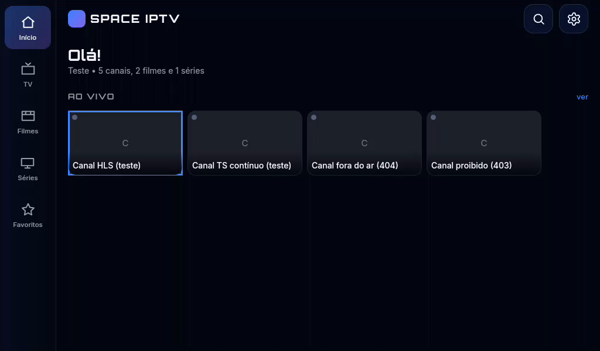
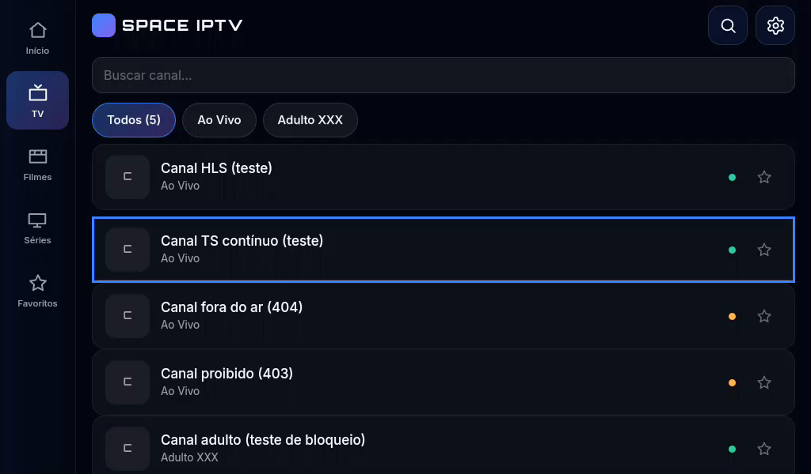
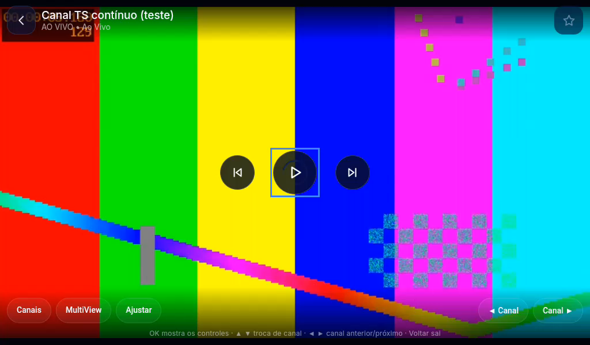
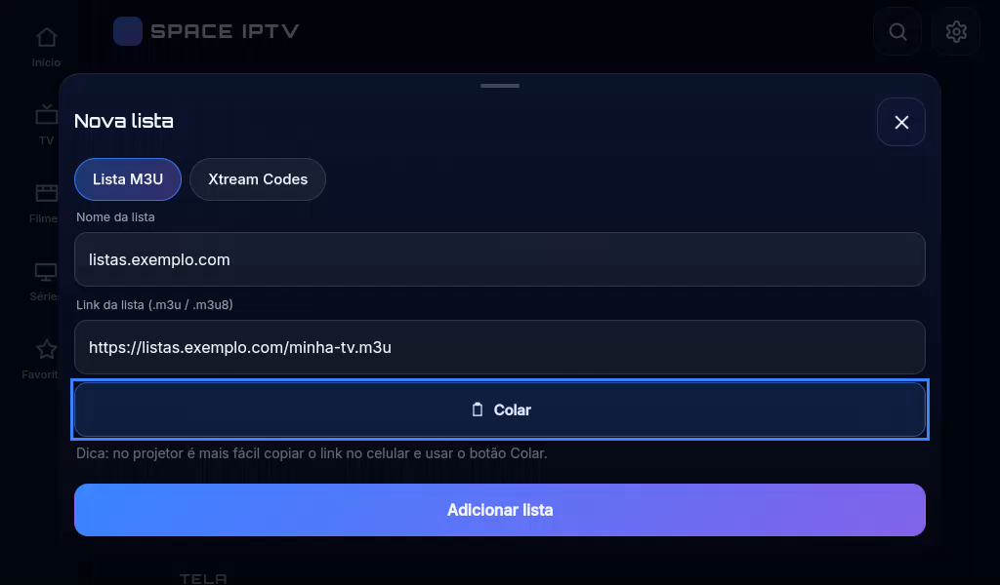
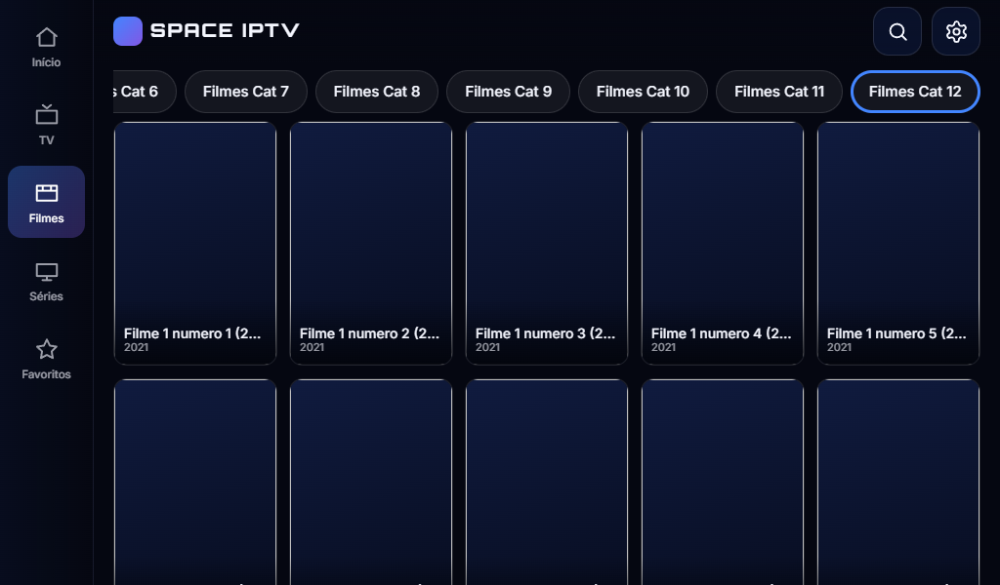
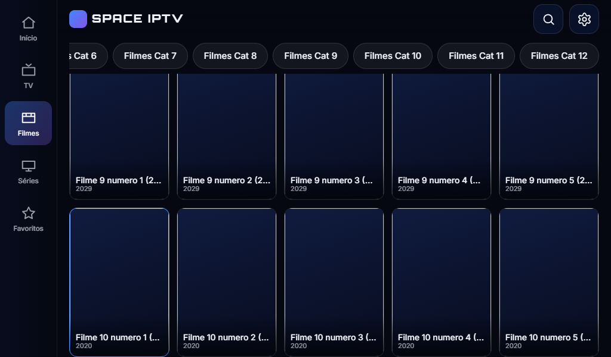
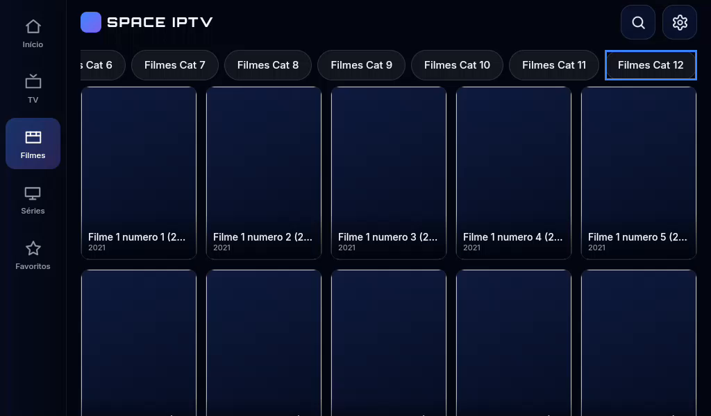
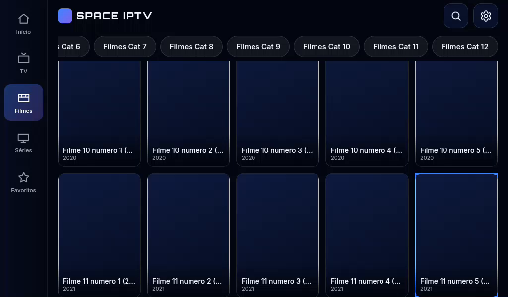

# Projetor e TV box (HY300)

O Space IPTV nasceu como app de TV (Tizen) e foi portado para celular. Num
**projetor Android** — o caso medido é o **HY300** — a tela e o jeito de usar são
outros: imagem larga de 1024×600, controle remoto no lugar do dedo, 1 GB de RAM e
uma WebView de 2018. Este documento explica o que o app faz para se adaptar, como
verificar e o que ainda não dá para fazer.

> Vale para qualquer aparelho parecido (TV box, stick, projetor), não só o HY300:
> a decisão é tomada pelo **tamanho da tela e pela memória**, nunca pelo nome do
> modelo.

## Como fica (HY300, 1024×600)

| Tela inicial | Canais ao vivo |
|---|---|
|  |  |

| Player com o anel no play | Nova lista com o botão Colar |
|---|---|
|  |  |

| Categorias rolando com a seta | Grade descendo além da primeira tela |
|---|---|
|  |  |

Fotos tiradas do próprio aparelho (`screenrecord` + extração de quadro), com o
controle remoto navegando — o anel azul é o item focado. As duas últimas saíram do
[harness](#9-como-testar), que reproduz a mesma janela e a mesma interface.

---

## 1. O que o aparelho impõe

Dados lidos do próprio HY300 por ADB:

| Característica | Valor | Consequência no app |
|---|---|---|
| Android **9 (API 28)** | WebView **Chrome 71** (2018) | Sem `inset`, `aspect-ratio`, `min()/max()/clamp()`, `gap` em flexbox, `backdrop-filter`. O CSS foi reescrito sem eles |
| **1 GB de RAM**, `low_ram`, heap de 128 MB | A35 4 núcleos | Visual sem efeitos caros, buffer de vídeo menor, menos sondagens de saúde |
| Tela **1024×600**, 160 dpi (densidade 1) | paisagem, sem toque real | Layout de TV: trilha lateral, alvos maiores, texto para ler de longe |
| **32 bits** (`armeabi-v7a`) | | O APK não tem código nativo, então instala e roda igual |
| Keystore quebrado (`ProviderException`) | | Credenciais passam a usar chave AES local (ver §7) |
| 55 fps, Mali-G31 | | Sem sombras/desfoques animados; a rolagem é o que importa |

O aparelho declara `android.hardware.touchscreen` **sem ter tela sensível** — por
isso o modo não pode ser decidido por "tem toque?".

---

## 2. Como o app escolhe o modo

`js/native.js` calcula no boot, e de novo a cada rotação:

```
modo = preferência do usuário  ("Automático" | "Celular" | "Projetor")
       senão: largura ≥ 960 e mais larga que alta  -> projetor
       senão: sem touchscreen declarado             -> projetor
       senão:                                       -> celular
```

O resultado vira duas classes no `<html>`:

| Classe | Efeito |
|---|---|
| `tv` | trilha lateral, `--rowh: 84px`, `--rail: 96px`, fontes e alvos maiores, dicas de controle |
| `low` | desliga gradientes decorativos, sombras, `drop-shadow` e animações de entrada |

Em **Configurações → Tela** o usuário pode fixar o modo (útil para um tablet, ou
para ver como fica no celular). "Automático" volta a decidir sozinho.

---

## 3. Layout de projetor

A barra de abas do celular vira uma **trilha à esquerda** — sem mudar o DOM, só
CSS (`#app` passa de `flex` para `grid`, com `grid-template-areas`). A ordem de
leitura fica igual à do app Tizen, então quem já usa a TV não se perde.

| Item | Celular | Projetor |
|---|---|---|
| Navegação | barra inferior, 60 px | trilha esquerda, 96 px |
| Altura da linha de canal (`--rowh`) | 76 px | 84 px |
| Barra de topo | 56 px | 64 px |
| Colunas de pôster | 3–4 | 5 (cartão de ~168 px) |
| Botão do player | 62 px | 76 px |
| Formulários e ajustes | largura toda | coluna de ~750 px, centrada |

O número de colunas sai da **largura útil** (descontando a trilha), não de valores
fixos por faixa — é o mesmo cálculo que já existia para o celular.

---

## 4. Controle remoto (o que torna o app usável)

Um projetor vem com controle IR (setas + OK + voltar) e, às vezes, um "air mouse"
2.4 GHz. Sem navegação por teclado, o app seria inutilizável. A camada
[`js/focus.js`](../celular/app/src/main/assets/mobile/js/focus.js) cuida disso:

- **descoberta automática** dos alvos: `button`, `.row`, `.poster`, `.chip`, `.toggle-row`,
  `.paste-btn`, `input` e qualquer `[data-f]` — nenhuma tela precisa registrar nada;
- **foco espacial**: a seta escolhe o vizinho geométrico daquela direção (distância
  no eixo, com penalidade para quem está fora de alinhamento — 3× por pixel);
- **anel visível** (`.foc`, `outline` azul) que não desloca nada no layout;
- **recuperação**: se a tela se redesenha (chegou catálogo, mudou a saúde dos
  canais) e o item focado desaparece, o anel volta para o item mais próximo — a
  cada 500 ms, sem custo perceptível;
- **camadas**: com diálogo ou folha aberta, o foco fica preso nela; ao fechar, volta
  para a tela;
- **primeira seta** cai no **conteúdo** da tela, nunca no botão de pesquisa da barra
  de cima nem no campo de busca (que abriria o teclado na hora errada).

### Teclas

| Tecla | Onde | Ação |
|---|---|---|
| ▲ ▼ ◀ ▶ | telas | move o foco |
| OK / Enter | telas | confirma o item; num campo de texto, abre o teclado |
| OK | player com controles escondidos | mostra os controles |
| ◀ ▶ | player (ao vivo) | canal anterior / próximo |
| ◀ ▶ | player (filme/série) | −10 s / +10 s |
| ▲ ▼ | player (ao vivo) | canal anterior / próximo |
| Voltar / Esc | em todo lugar | fecha diálogo, folha, tela ou o player |
| ⏯ / ⏭ / ⏮ (mídia) | player | pausa, próximo, anterior (o Android entrega ao Java, que repassa ao app) |

`KEYCODE_MEDIA_*` e `CHANNEL_UP/DOWN` são traduzidos em `MainActivity.dispatchKeyEvent`
para `{type:"key"}` e chegam ao player. Para as setas funcionarem, a `WebView` precisa
ter foco — `MainActivity` chama `requestFocus()` explicitamente (era isso que fazia
o controle "não fazer nada" na primeira versão).

O mouse/air mouse continua funcionando por cima: ao mover o cursor, o anel sai de
cena e o clique vale normalmente.

---

### Faixas e listas que rolam

Duas regras fazem a seta "continuar" em vez de morrer na borda (corrigido na 1.0.5):

- **quem está alinhado ganha.** Ao ir para a direita, um item que divide a mesma
  faixa horizontal tem preferência sobre qualquer coisa um pouco mais perto mas
  deslocada. Sem isso a seta pulava da última categoria para o cartão de baixo (ou
  para a trilha lateral) em vez de caminhar na faixa;
- **a seta pode sair da tela.** Itens fora da janela continuam sendo candidatos, e
  o `scrollIntoView` traz a faixa/grade junto. Quando o item ainda não existe no
  DOM (lista virtualizada), a camada rola o container um passo e tenta de novo —
  é o que faz a grade de filmes continuar descendo depois da primeira tela.

O foco inicial de cada tela continua preferindo o que já está à vista, para abrir
uma tela não rolar a página sozinho.

Confirmado no aparelho com as teclas reais do controle (12× ▶ e 11× ▼):

| Categorias: 12× ▶ | Grade: 11× ▼ |
|---|---|
|  |  |

## 5. Colar o link da lista

Digitar uma URL com o controle do projetor é inviável. No formulário de lista, o
campo **Link da lista** ganhou o botão **Colar** (no celular, ao lado do campo; no
projetor, embaixo dele — é o caminho natural da seta ▼).

O botão lê a **área de transferência do Android** pela ponte nativa
(`SpaceNative.clipboard()`). A WebView não conseguiria: a página roda em `file://`
e o toque longo está desligado de propósito.

O texto colado é limpo antes de entrar no campo:

| Colado | Vira |
|---|---|
| `Segue a lista: "https://servidor.com/lista.m3u"` | `https://servidor.com/lista.m3u` |
| `http://a.b:8080/get.php?username=x&password=y&type=m3u_plus` | igual (preserva a query) |
| `   ` | nada (aviso "Não há nada para colar") |
| texto sem link | o texto sem as aspas |

Se o campo **Nome** estiver vazio, ele é preenchido com o domínio
(`servidor.com`), e depois de salvar a primeira lista o app já abre a tela inicial.

O mesmo botão aparece nos campos do **Xtream Codes** (servidor, usuário, senha).

Para levar um link até o projetor: copie no celular/navegador e cole no projetor
por um app de área de transferência compartilhada, ou copie de uma página aberta no
próprio projetor. (Um envio direto do celular para o projetor é um próximo passo
possível, ainda não implementado.)

---

## 6. Desempenho e memória

Com 1 GB de RAM e uma GPU de 2018, o que pesa é o que o compositor redesenha.

| Medida | Onde | Por quê |
|---|---|---|
| `html.low` desliga `body::after` (poeira estelar) e troca o fundo graduado por um gradiente linear | `mobile.css` | o fundo é fixo; qualquer camada extra é repintada junto com a rolagem |
| sem `box-shadow`/`drop-shadow` e sem animação de entrada | `html.low` | sombra em SVG de cada aba custa caro por quadro |
| buffer do ExoPlayer 10 s / teto de 16 MB | `PlayerManager` | o padrão (60 s) estoura a heap de 128 MB junto com a WebView |
| saúde dos canais: concorrência 2, fila 40, histórico 2 500 | `App.health.configure` | evita 3 requisições simultâneas num A35 |
| `img.loading` não é usado | `ui.js` | `loading="lazy"` é do Chrome 77; aqui seria ignorado |

O MultiView funciona, mas dois decodificadores simultâneos num RK3326 podem falhar;
o app já trata isso ("Este aparelho não abriu o segundo canal") sem interromper o
principal.

---

## 7. Credenciais no projetor

O Keystore do HY300 responde **`ProviderException: Keystore operation failed`** para
qualquer chave AES (256 e 128 bits) — imagem `userdebug` de fabricante. O app tem
três níveis, e escolhe o melhor disponível:

| Prefixo | O que é | Quando |
|---|---|---|
| `n1:` | AES-GCM com chave no **AndroidKeyStore** (hardware quando há TEE) | celular, TVs, a maioria dos aparelhos |
| `l1:` | AES-GCM com chave aleatória de 32 bytes guardada nas preferências do app | aparelhos com Keystore quebrado (HY300) |
| `p0:` | base64 (última reserva) | só se nem a chave local puder ser criada |

Os três são lidos por versões novas: atualizar o app não obriga a recadastrar nada.
Diagnóstico aparece no log: `adb logcat -s SpaceSecrets`.

---

## 8. Compatibilidade de WebView (regra do projeto)

Como o motor é o Chrome 71, tudo em `assets/mobile` é escrito sem recursos
posteriores a 2018. Em vez de `inset: 0`, usa-se `top/right/bottom/left: 0`; em vez
de `aspect-ratio`, `padding-bottom` **num filho bloco** (dentro de um flex o
percentual é calculado sobre a largura do container, e o cartão viraria um bloco
gigante — foi exatamente o bug encontrado no primeiro teste no aparelho); em vez de
`gap`, margem entre irmãos.

[`tools/test-compat.js`](../tools/test-compat.js) falha se alguém reintroduzir um
desses recursos:

```
node tools\test-compat.js
  ok   nenhum recurso de CSS posterior ao Chrome 71
  ok   nenhum `gap` de flexbox (so grid)
  ok   nenhuma sintaxe/API de JavaScript posterior a 2018
  ok   index.html carrega a camada Android inteira (23 scripts)
```

---

## 9. Como testar

**Foto da tela.** Em algumas imagens Rockchip o `screencap` devolve arquivo vazio.
O caminho que funciona é gravar e extrair um quadro:

```
adb -s 192.168.0.6:5555 shell "screenrecord --time-limit 3 --size 1024x600 /data/local/tmp/v.mp4"
adb -s 192.168.0.6:5555 pull /data/local/tmp/v.mp4 v.mp4
ffmpeg -i v.mp4 -update 1 -frames:v 1 -y tela.png
```

**Bateria completa.** A mesma suíte do celular roda no projetor, apontando o
servidor de testes para o IP da máquina:

```
$env:ADB_SERIAL = "192.168.0.6:5555"
.\tools\cdp.ps1
$env:MOCK = "192.168.0.5:8090"      # IP da maquina na rede
node tools\e2e.js
```

**Colar de verdade**, sem digitar: `node tools\clip.js "http://..."` põe o texto na
área de transferência do aparelho (o clique é injetado pelo protocolo porque a
WebView só copia a partir de um gesto real).

**Sem aparelho nenhum.** Quando o projetor (ou o celular) está ocupado, dá para abrir
a mesma interface no navegador da máquina, na mesma janela e com um `SpaceNative`
falso que se apresenta como o HY300:

```powershell
.\tools\harness.ps1                      # 1024x600, modo projetor
$env:CDP_PORT = "9333"; node tools\cdp.js "App.m.tv"
.\tools\harness.ps1 -Width 360 -Height 740   # jeito celular
```

Serve para layout e navegação por setas. **Não** serve para reprodução de vídeo
(não há ExoPlayer) nem para a área de transferência real (o stub devolve texto fixo).

Resultado em 09/11/2026: **122 de 122 verificações** no HY300 (WebView 71) e no
Galaxy J4 Core (Android 8.1), incluindo o bloco de setas em faixas e listas longas.

---

## 10. O que ainda não é possível

- **Ler a área de transferência de outro aparelho** (celular → projetor) direto: hoje
  depende de o texto já estar no clipboard do projetor. Um envio por rede local
  (código curto na tela) seria o próximo passo.
- **Ajustar foco/trapézio do projetor** pelo app: é do sistema (o acelerômetro é usado
  por um app do fabricante), não há API pública.
- **Garantir MultiView** em qualquer projetor: depende de o SoC ter dois decodificadores.
